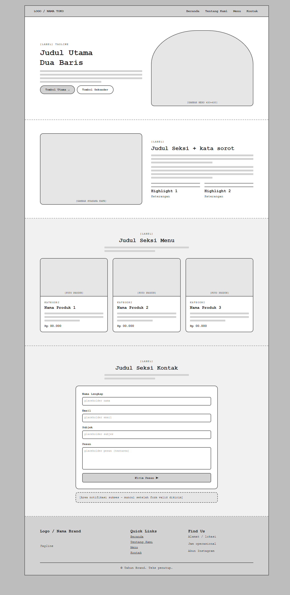

# Tugas Praktikum Pertemuan 4 - Desain Web

**Nama:** Khairul Adam Efendi  
**NPM:** 4525210035  
**Kelas:** A

# Website Wireframe

Wireframe merupakan rancangan awal website. Wireframe dibuat menggunakan **HTML dan CSS** dengan tampilan low-fidelity (grayscale) agar susunan halaman, posisi elemen, dan alur informasi dapat direncanakan sebelum masuk ke tahap desain visual dan implementasi website.

Rancangan ini berfokus pada lima bagian utama, yaitu Hero, Tentang Kami, Menu, Kontak, dan Footer. Elemen yang belum memiliki konten final masih menggunakan teks placeholder dan kotak gambar sebagai penanda.

## Struktur Proyek

```text
Pertemuan-ke-5_Praktikum-Desweb-A_4525210035_Khairul-Adam-Efendi/
├── index.html
├── css/
│   └── style.css
└── README.md
```

## Output



## Susunan Halaman

| No | Bagian | Penerapan |
|---|---|---|
| 1 | Navbar | Menampilkan identitas Selaras Coffee dan tautan navigasi Beranda, Tentang Kami, Menu, dan Kontak. |
| 2 | Hero Section | Area pembuka berisi tagline, judul utama, deskripsi, dua tombol, dan placeholder gambar utama. |
| 3 | Tentang Kami | Menampilkan placeholder foto suasana kafe, judul, deskripsi, dan dua poin highlight. |
| 4 | Menu | Menampilkan tiga kartu produk dengan placeholder foto, kategori, nama produk, deskripsi, dan harga. |
| 5 | Kontak | Menampilkan rancangan form nama lengkap, email, subjek, pesan, tombol kirim, dan area notifikasi. |
| 6 | Footer | Menampilkan identitas brand, tagline, quick links, lokasi, jam operasional, Instagram, dan hak cipta. |

## Cara Menjalankan

1. Pastikan struktur folder sesuai dengan bagan Struktur Proyek.
2. Pastikan file `index.html` memanggil stylesheet melalui `<link rel="stylesheet" href="css/style.css">`.
3. Buka `index.html` menggunakan browser.
4. Ubah ukuran jendela browser untuk melihat penyesuaian layout pada tampilan mobile.