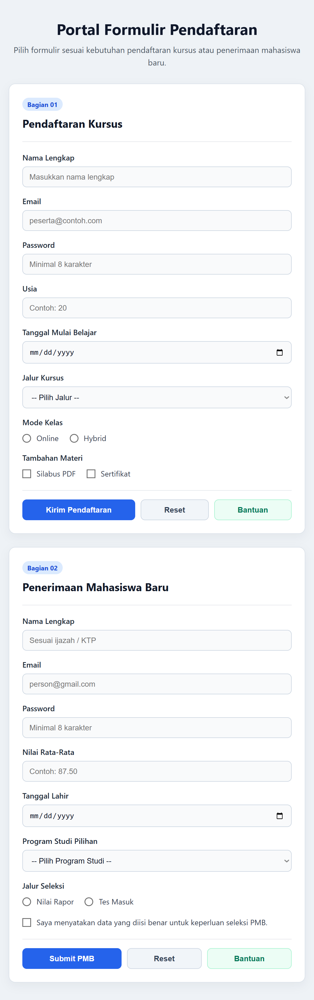

# Tugas Praktikum Desain Web 7 — Portal Formulir Pendaftaran

**Nama:** Khairul Adam Efendi  
**NPM:** 4525210035  
**Kelas:** A  

---

# Portal Formulir Pendaftaran (Kursus & Penerimaan Mahasiswa Baru)

Halaman prototipe HTML dan CSS yang memuat **dua formulir terpisah dalam satu dokumen (`index.html`)** dengan penataan satu kolom vertikal (Form 1 di atas, Form 2 di bawah).

Pengerjaan merancang prototipe formulir pendaftaran kursus dengan beragam tipe input dan tiga jenis tombol, serta formulir studi kasus penerimaan mahasiswa baru (PMB) yang disiapkan agar setiap field memiliki `label`, `id`, `name`, dan tipe input yang sesuai untuk integrasi backend.

## Struktur Proyek

```text
Pertemuan-ke-7_Praktikum-Desweb-A_4525210035_Khairul-Adam-Efendi/
├── index.html
├── css/
│   └── style.css
├── output.png
└── README.md
```

## Output



## Pemenuhan Ketentuan Tugas & Studi Kasus

| No | Ketentuan | Penerapan pada Prototipe |
|---|---|---|
| 1 | Dua formulir dalam 1 HTML | `#formKursus` (Bagian 01) dan `#formPMB` (Bagian 02) di dalam `index.html` |
| 2 | Form 1: minimal 5 tipe input | `text`, `email`, `password`, `number`, `date`, ditambah `select`, `radio`, dan `checkbox` |
| 3 | Form 1: minimal 3 jenis button | `type="submit"`, `type="reset"`, dan `type="button"` pada `.action-bar` |
| 4 | Label terhubung ke kontrol | Setiap `<label>` memakai `for` yang cocok dengan `id` kontrol |
| 5 | Form 2 (PMB): data minimum | `nama_lengkap` (`text`), `email` (`email`), `password` (`password`), `nilai_rata_rata` (`number`), dan `tanggal_lahir` (`date`) |
| 6 | Kesiapan integrasi backend | Atribut `method="POST"` pada form serta nama field `name` yang konsisten dan deskriptif |

### A. Pada penyusunan dan modifikasi HTML & CSS

| No | Masalah | Dampak | Solusi |
|---|---|---|---|
| 1 | Dua `<option>` pada `#pmbProdi` sempat memiliki `value="teknik_elektro"`. | Nilai yang terkirim ke backend bisa tertukar antara Teknik Elektro dan Teknik Industri. | Dibedakan nilainya (`teknik_elektro` dan `teknik_industri`). |
| 2 | Risiko bentrok `id` pada dua form dalam satu file HTML. | Klik pada `<label>` bisa mengarah ke input yang salah jika `id` sama. | Setiap kontrol diberi `id` unik (`kursusNama` vs `pmbNama`, `kursusEmail` vs `pmbEmail`, dst.). |

## Responsivitas

Tata letak menggunakan satu kolom vertikal di dalam `.wrapper` (`max-width: 720px`) dengan `padding` samping pada `body` serta `flex-wrap: wrap` pada `.option-row` dan `.action-bar` agar input, pilihan radio/checkbox, dan tombol tetap rapi di berbagai ukuran layar.

## Cara Menjalankan

1. Pastikan file `index.html`, `css/style.css`, dan gambar tangkapan layar `output.png` berada pada struktur folder yang sesuai.
2. Buka `index.html` langsung di browser (tidak memerlukan dependensi eksternal maupun koneksi internet).