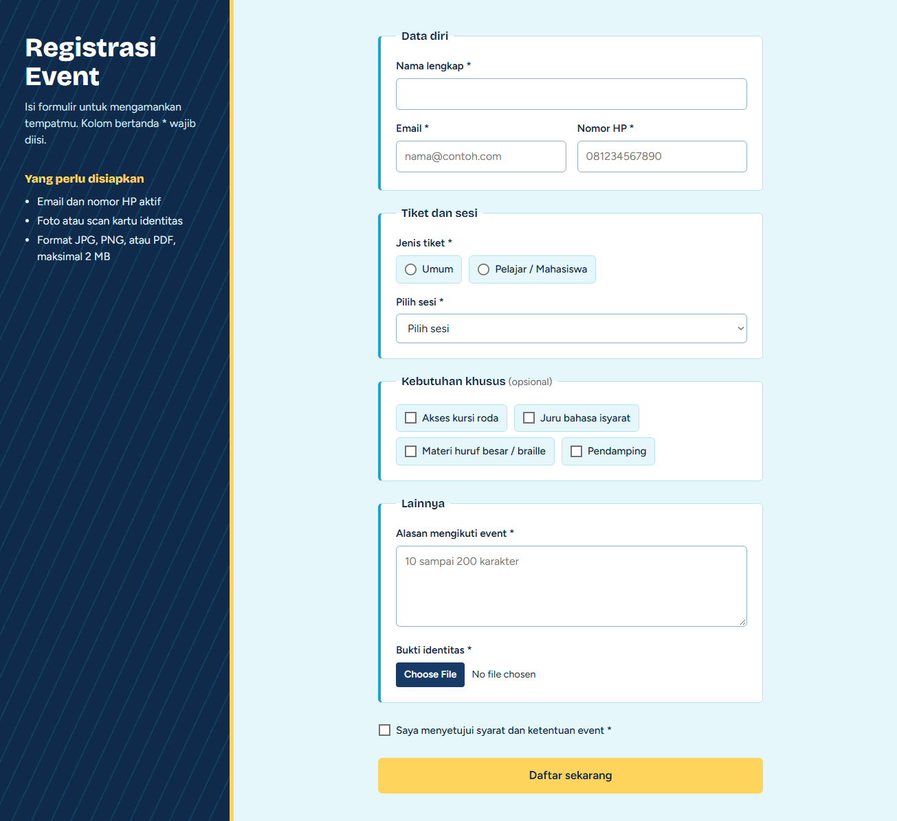

# Tugas Praktikum Desain Web 8 — Registrasi Event

**Nama:** Khairul Adam Efendi  
**NPM:** 4525210035  
**Kelas:** A  

---

# Registrasi Event – Form Pendaftaran

Web **Registrasi Event** merupakan halaman formulir pendaftaran event yang dibuat menggunakan HTML, CSS, dan JavaScript.

## Fitur Utama

- **Nama Lengkap:** Input nama peserta.
- **Email:** Input alamat email peserta.
- **Nomor HP:** Input nomor telepon peserta.
- **Radio Button:** Memilih jenis tiket (Umum atau Pelajar/Mahasiswa).
- **Select Option:** Memilih sesi acara.
- **Checkbox (Opsional):** Checklist kebutuhan khusus, seperti akses kursi roda, juru bahasa isyarat, materi huruf besar/braille, dan pendamping.
- **Textarea:** Menuliskan alasan mengikuti event.
- **File Upload:** Mengunggah bukti identitas peserta.
- **Checkbox Persetujuan:** Menyetujui syarat dan ketentuan event.
- **Form Validation:** Memvalidasi seluruh input sebelum pendaftaran dinyatakan berhasil.
- **Alert Sukses:** Menampilkan pemberitahuan setelah seluruh validasi terpenuhi, lalu mengosongkan form.
- **Responsive Design:** Tampilan menyesuaikan ukuran layar desktop dan mobile.

## Teknologi yang Digunakan

| Teknologi | Kegunaan |
|---|---|
| HTML5 | Membuat struktur form |
| CSS3 | Mengatur tampilan dan desain |
| JavaScript | Membuat validasi input dan menampilkan pesan error |
| Google Fonts (Bricolage Grotesque, Figtree) | Mengatur tipografi |

## Struktur Project

```text
Pertemuan-ke-8_Praktikum-Desweb-A_4525210035_Khairul-Adam-Efendi/
│
├── index.html
├── css/
│   └── style.css
├── output.png
└── README.md
```

## Aturan Validasi

Berikut aturan validasi yang diterapkan pada form:

1. Nama lengkap wajib diisi minimal 3 karakter dan hanya boleh berisi huruf, spasi, titik, atau apostrof (maksimal 50 karakter).
2. Email wajib menggunakan format email yang valid.
3. Nomor HP wajib diawali `08` dan terdiri dari 10–13 digit angka.
4. Jenis tiket wajib dipilih.
5. Sesi acara wajib dipilih.
6. Alasan mengikuti event wajib diisi minimal 10 karakter (maksimal 200 karakter).
7. Bukti identitas wajib diunggah.
8. File harus berformat JPG, PNG, atau PDF.
9. Ukuran file maksimal 2 MB.
10. Checkbox persetujuan wajib dicentang.
11. Kebutuhan khusus bersifat opsional, sehingga boleh dikosongkan.

## Cara Menjalankan Project

1. Download atau clone repository ini.
2. Pastikan `index.html` dan `style.css` berada dalam satu folder.
3. Buka file `index.html` menggunakan browser.
4. Isi data pada form registrasi.
5. Klik tombol **Daftar sekarang**.
6. Perhatikan pesan error yang muncul di bawah kolom apabila terdapat input yang tidak sesuai.
7. Jika seluruh input valid, akan muncul alert bahwa form berhasil dikirim.

## Pengujian Form

Pengujian dilakukan dengan mencoba skenario input yang tidak valid maupun valid. Kolom **Hasil Aktual** diisi dengan pesan yang tampil pada halaman setelah tombol **Daftar sekarang** diklik.

| No | Field | Input Uji | Hasil yang Diharapkan | Hasil Aktual |
|---|---|---|---|---|
| 1 | Nama | `Al` (2 karakter) | Ditolak, minimal 3 karakter | Muncul pesan "Nama minimal 3 karakter." |
| 2 | Nama | `Budi123` | Ditolak, hanya huruf yang diizinkan | Muncul pesan "Nama hanya boleh berisi huruf, spasi, titik, atau apostrof." |
| 3 | Email | `budi@` | Ditolak, format email tidak valid | Muncul pesan "Masukkan email dengan format yang benar, misalnya nama@contoh.com." |
| 4 | Nomor HP | `12345` | Ditolak, harus diawali 08 dan 10–13 digit | Muncul pesan "Nomor HP harus diawali 08 dan terdiri dari 10-13 digit angka." |
| 5 | Nomor HP | `08abc123456` | Ditolak, harus berisi angka saja | Muncul pesan "Nomor HP harus diawali 08 dan terdiri dari 10-13 digit angka." |
| 6 | Jenis tiket | Tidak memilih radio | Ditolak, wajib memilih salah satu | Muncul pesan "Pilih salah satu jenis tiket." |
| 7 | Sesi | Tetap pada "Pilih sesi" | Ditolak, wajib memilih sesi | Muncul pesan "Pilih sesi yang ingin diikuti." |
| 8 | Alasan | `Ingin ikut` (kurang dari 10 karakter) | Ditolak, minimal 10 karakter | Muncul pesan "Alasan minimal 10 karakter." |
| 9 | Bukti identitas | Tidak memilih file | Ditolak, wajib diunggah | Muncul pesan "Unggah bukti identitas." |
| 10 | Bukti identitas | File `.docx` atau `.exe` | Ditolak, format tidak sesuai | Muncul pesan "Format file harus JPG, PNG, atau PDF." |
| 11 | Bukti identitas | File JPG lebih dari 2 MB | Ditolak, melebihi batas ukuran | Muncul pesan "Ukuran file maksimal 2 MB." |
| 12 | Persetujuan | Checkbox tidak dicentang | Ditolak, wajib dicentang | Muncul pesan "Centang persetujuan untuk melanjutkan." |
| 13 | Kebutuhan khusus | Dikosongkan, field lain valid | Form tetap berhasil dikirim | Alert "Form berhasil dikirim!" muncul |
| 14 | Semua field | Seluruh data diisi dengan benar | Form berhasil dikirim | Alert "Form berhasil dikirim! Ini hanya tampilan, data tidak disimpan." muncul dan form dikosongkan |

## Validasi Client-Side

Seluruh proses validasi pada project ini dilakukan menggunakan JavaScript di browser (Client-Side Validation).

Validasi ini meliputi pemeriksaan:
- Input kosong.
- Format nama, email, dan nomor HP.
- Minimal dan maksimal panjang karakter.
- Pilihan radio, select, dan checkbox persetujuan.
- Format serta ukuran file yang diunggah.

## Output



## Informasi Project

- **Nama Project:** Registrasi Event
- **Jenis Project:** Event Registration Form
- **Kategori:** Front-End Development
- **Bahasa:** HTML, CSS, JavaScript
- **Tahun:** 2026

---