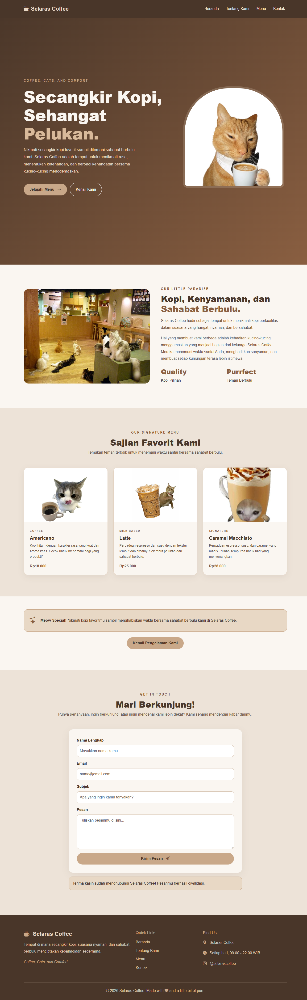

# Selaras Coffee — One Page Website

Website company profile satu halaman untuk **Selaras Coffee**, UMKM kedai kopi dengan konsep *Coffee, Cats, and Comfort*. Website ini disiapkan agar dapat dipresentasikan kepada calon pelanggan dan mitra bisnis, dibangun dengan **Bootstrap 5** dan diberi identitas sendiri lewat custom CSS.

Pengerjaan berawal dari file contoh praktikum **`contoh1.html`** dan **`contoh1.css`** (Katalog Produk dengan Bootstrap Grid System), lalu dikembangkan sesuai kebutuhan studi kasus Pak Ari.

## Struktur Proyek

```
selaras-coffee/
├── index.html
├── css/
│   └── style.css
├── img/
│   ├── selaras-coffee.jpg
│   ├── coffee-shop.jpg
│   ├── coffee-1.jpg
│   ├── coffee-2.jpg
│   └── coffee-3.jpg
└── README.md
```

## Output


## Pemenuhan Ketentuan Studi Kasus

| No | Komponen wajib | Penerapan |
|---|---|---|
| 1 | Navbar responsif | `navbar-expand-lg` dengan tombol toggler, menjadi menu lipat di layar kecil |
| 2 | Hero section | Judul, deskripsi, dua tombol aksi, dan foto utama |
| 3 | Minimal 3 card | 3 card menu: Americano, Latte, Caramel Macchiato |
| 4 | Minimal 1 alert | Alert promo dan alert sukses form kontak |
| 5 | Minimal 1 modal | Modal sambutan "Welcome to Selaras Coffee!" |
| 6 | Form kontak | Nama, email, subjek, pesan |
| 7 | Footer | Profil, tautan cepat, jam buka, Instagram, hak cipta |
| 8 | Custom CSS | Branding warna, tipografi, tombol, kartu, modal, form, dan footer |

## Perubahan

1. **Dari katalog umum menjadi company profile.** Halaman yang tadinya hanya grid produk dirombak menjadi website satu halaman yang bercerita tentang kedai: siapa kami, apa yang kami jual, promo, dan cara menghubungi kami.
2. **Konten disesuaikan dengan bisnis.** Placeholder diganti dengan konsep *Coffee, Cats, and Comfort*, lengkap dengan slogan, deskripsi, harga, dan jam buka.

## Masalah yang Ditemukan dan Solusi

### A. Pada contoh awal (`contoh1`) terhadap kebutuhan studi kasus

| No | Masalah | Solusi |
|---|---|---|
| 1 | Hanya berisi grid kartu. Navbar, hero, alert, modal, dan form kontak belum ada, padahal semuanya wajib. | Ditambahkan seluruh komponen wajib dalam satu halaman dengan navigasi antar-bagian. |
| 2 | Tampilan memakai biru bawaan Bootstrap, tanpa identitas bisnis. | Dibuat palet cokelat kopi dan krem lewat custom CSS yang konsisten di semua komponen. |
| 3 | Konten placeholder ("Produk 1", "Deskripsi singkat mengenai produk pertama"). | Diganti informasi nyata Selaras Coffee: menu, harga, promo, dan jam buka. |
| 4 | Tidak ada notifikasi promo dan interaksi bagi pengunjung. | Ditambahkan alert promo, modal sambutan, dan form kontak dengan umpan balik sukses. |

### B. Pada pengembangan custom CSS Selaras Coffee

| No | Masalah | Dampak bagi Selaras Coffee | Solusi |
|---|---|---|---|
| 1 | Foto menu memakai `object-fit: fill`. | Foto kopi tertarik dan tampak gepeng. | Diganti `object-fit: cover` agar proporsional dan seragam. |
| 2 | Reset `* { margin: 0; padding: 0; }`. | Mengganggu spasi bawaan Bootstrap dan berisiko merusak tata letak komponen. | Reset dihapus karena Bootstrap sudah memiliki reboot dan `box-sizing` sendiri. |
| 3 | Tombol utama berubah transparan saat ditekan (`btn-main` tidak punya state `:active`). | Saat pengunjung mengetuk "Jelajahi Menu" atau "Kirim Pesan", tombol sempat tampak hilang. | Ditambahkan state `:active` dan `:focus-visible` yang tetap memakai warna brand. |
| 4 | Form kontak tampil polos tanpa kartu. | Bagian kontak terlihat kurang rapi dibanding section lain. | Form diberi gaya kartu (latar krem, sudut membulat, bayangan halus). |

## Responsivitas

Pola grid dari contoh (`col-md-6 col-lg-*`) dipertahankan dan diperluas ke seluruh halaman.

- **Layar besar (≥ 992px):** navbar horizontal, hero dua kolom, menu 3 kartu sebaris.
- **Tablet (< 992px):** navbar menjadi menu lipat, hero rata tengah, foto utama dikecilkan, menu 2 kartu sebaris.
- **HP (< 576px):** spasi section dan ukuran judul dikurangi, menu 1 kartu per baris, padding form disesuaikan.

## Cara Menjalankan

1. Pastikan struktur folder sesuai bagan di atas dan semua gambar sudah ada di folder `img/`.
2. Buka `index.html` di browser. Koneksi internet dibutuhkan untuk memuat Bootstrap dan Bootstrap Icons dari CDN.